<p align="center">
  <picture>
    <source media="(prefers-color-scheme: dark)" srcset="docs/mirmire/logo-on-dark.png">
    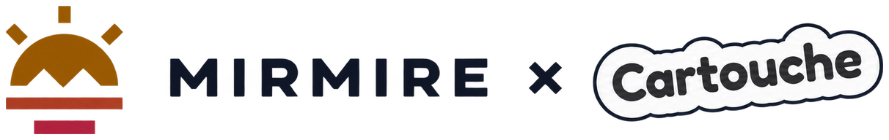
  </picture>
</p>

<table align="center">
<tr>
<td align="center">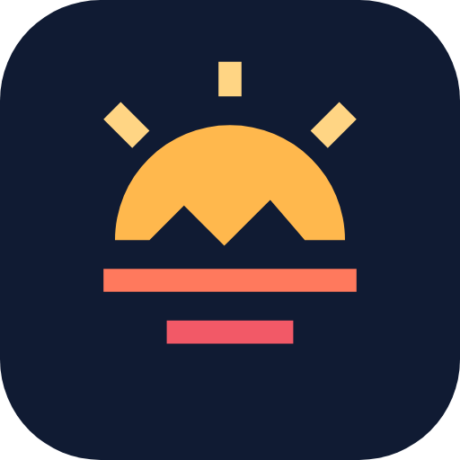<br><b><a href="https://github.com/Mirmire-Launcher">Mirmire</a></b></td>
<td align="center"><br><b><a href="https://github.com/Hakimba/cartouche">Cartouche</a></b><br>by Hakimba</td>
</tr>
</table>

# Mirmire Cartouche

The 3D Big Picture mode of [Mirmire](https://github.com/Mirmire-Launcher), the handheld launcher: your consoles as
3D models, your games as their real discs, cartridges and UMDs, and a 3D home to get to all of it.

> **Mirmire Cartouche is a fork of [Cartouche](https://github.com/Hakimba/cartouche) by Hakimba and its
> contributors**, the game launcher that shows games as physical discs and cartridges. Its 3D shelves, consoles,
> launches and label artwork are Cartouche's work. Mirmire Cartouche connects them to Mirmire and adds a home around
> them. It is released under the same licence, the GNU GPL v3 or later ([LICENSE](LICENSE)). Cartouche's own README
> is kept in [docs/cartouche-README.md](docs/cartouche-README.md).

<p align="center">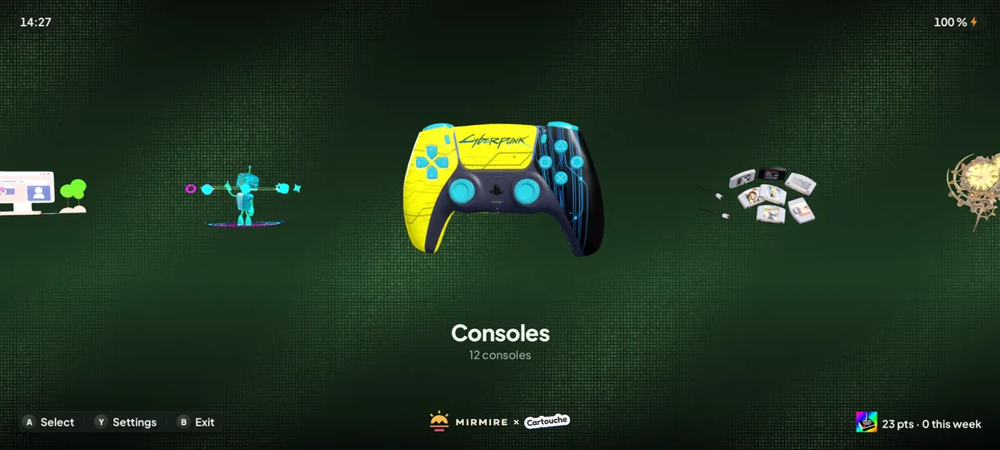</p>

## The home

Mirmire's Big Picture, in 3D: each card a model that floats when chosen, plays its own animation and turns under
your finger. The bottom bar has the button hints, the Mirmire × Cartouche logo and your RetroAchievements.

<table>
<tr>
<td width="33%">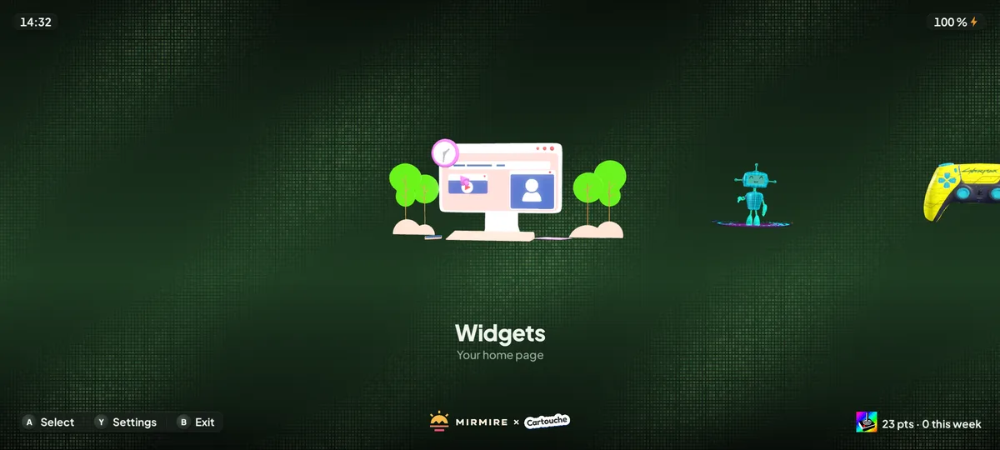<br><b>Widgets</b>: your Mirmire home page</td>
<td width="33%">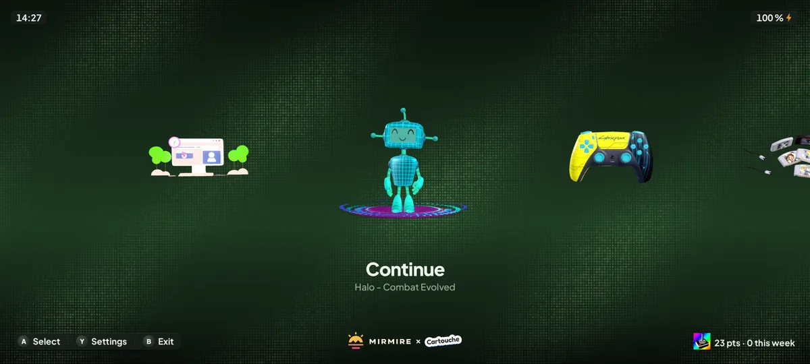<br><b>Continue</b>: plays your last game</td>
<td width="33%"><br><b>Consoles</b>: into the 3D shelves</td>
</tr>
<tr>
<td width="33%">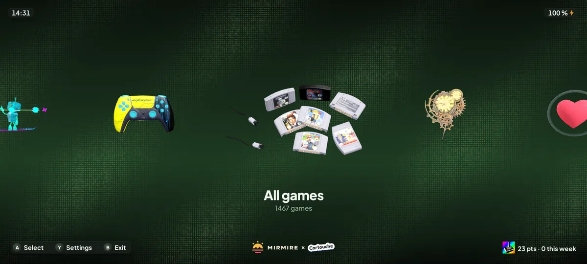<br><b>All games</b></td>
<td width="33%">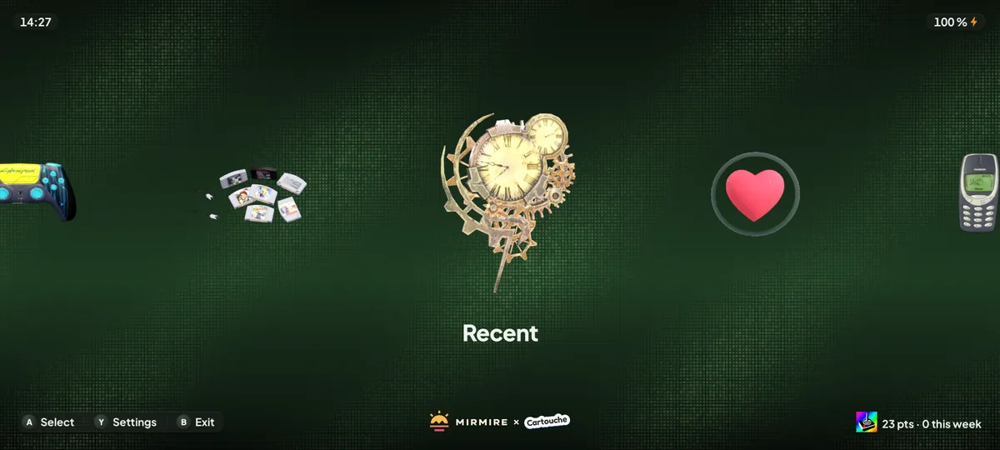<br><b>Recent</b></td>
<td width="33%">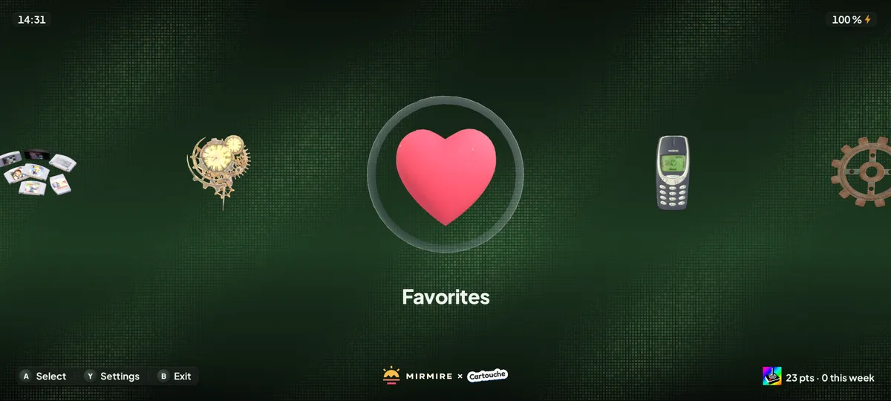<br><b>Favorites</b></td>
</tr>
<tr>
<td width="33%">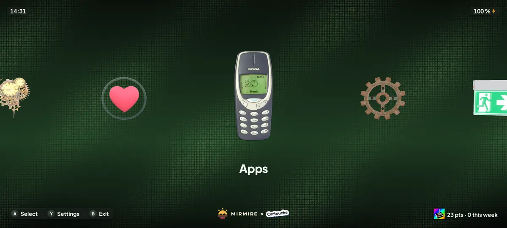<br><b>Apps</b></td>
<td width="33%">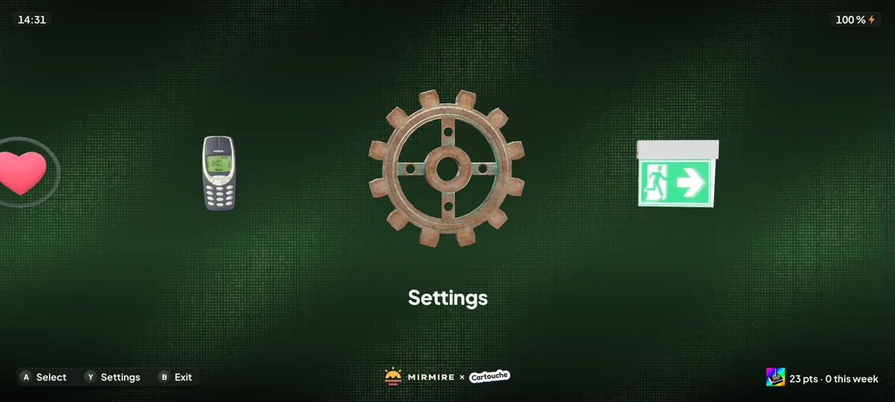<br><b>Settings</b>: Mirmire's settings</td>
<td width="33%">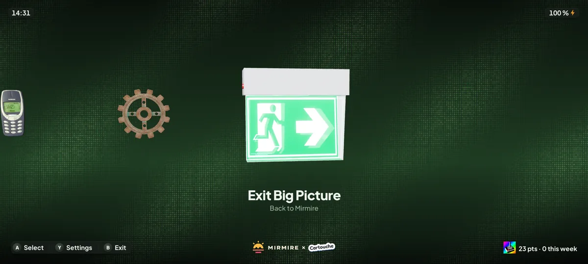<br><b>Exit Big Picture</b>: back to Mirmire</td>
</tr>
</table>

## Your consoles and games

<table>
<tr>
<td width="50%">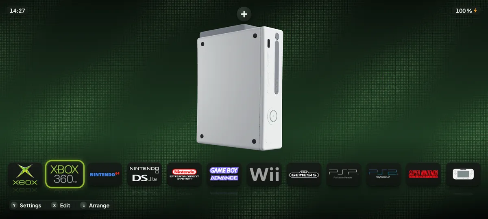<br><b>Your consoles:</b> every console in your Mirmire library, a 3D model where there is one, a styled console with its name otherwise.</td>
<td width="50%">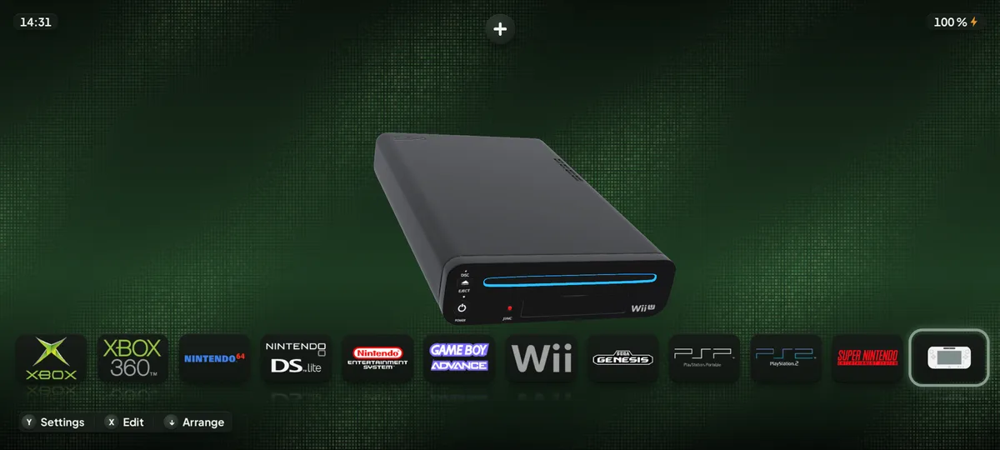<br><b>More consoles:</b> Wii U, PS3, Saturn, 3DS XL, Steam Deck, Atari 2600 and Lynx, Neo Geo Pocket and more.</td>
</tr>
<tr>
<td>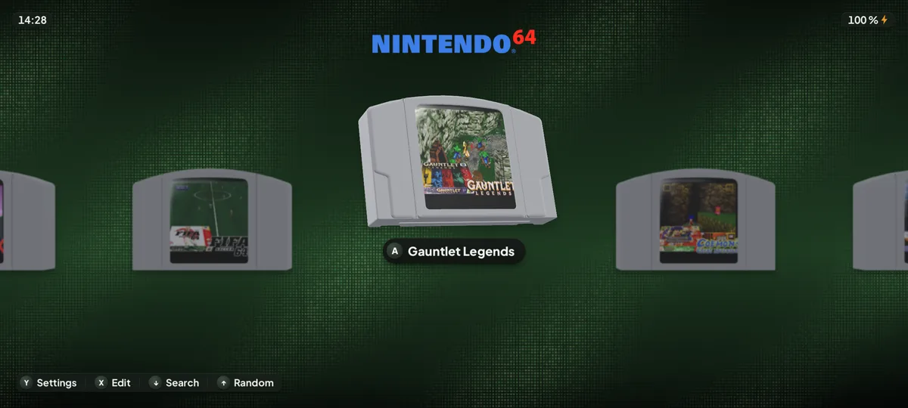<br><b>Your games, with their art:</b> Mirmire's box art and disc scans become the labels on each cartridge and disc.</td>
<td>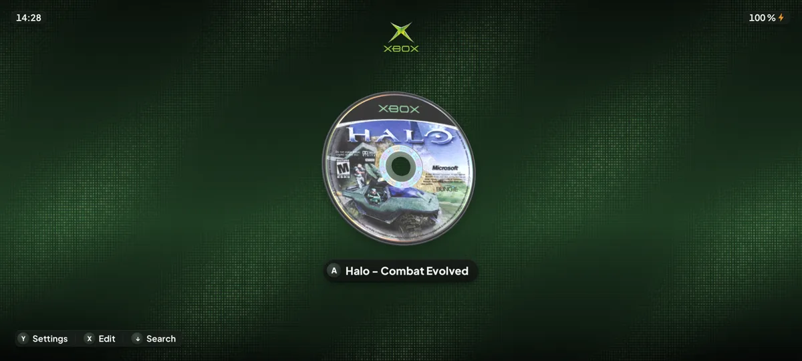<br><b>Played by Mirmire:</b> tap a game, or press A, and Mirmire starts it with its own emulator choice, downloads, saves, achievements and play time.</td>
</tr>
<tr>
<td>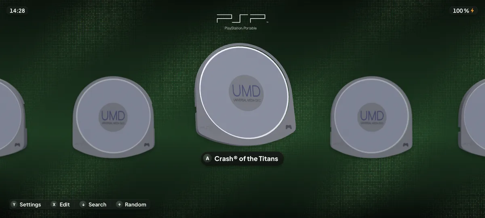<br><b>More media:</b> PSP games on UMDs, alongside Cartouche's discs and cartridges.</td>
<td></td>
</tr>
</table>

## In Mirmire

<table>
<tr>
<td width="50%">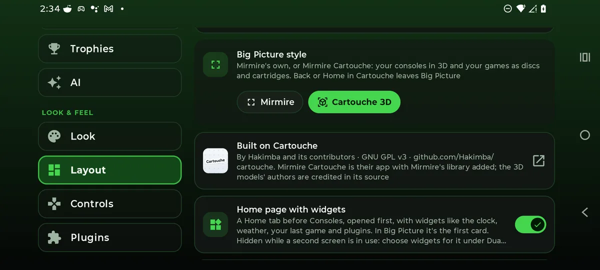<br><b>Big Picture style:</b> Mirmire's own, or Cartouche 3D, with the credit to Cartouche.</td>
<td width="50%">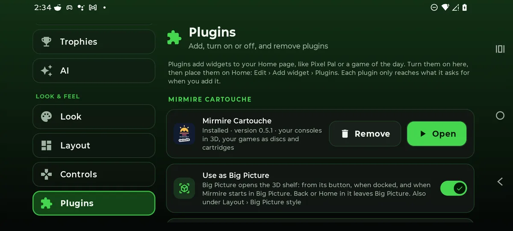<br><b>Settings › Plugins:</b> install, open or remove Mirmire Cartouche, and use it as Big Picture.</td>
</tr>
</table>

## How it works with Mirmire

- **Install and choose it in Mirmire.** Settings › Plugins installs Mirmire Cartouche; Settings › Layout › Big
  Picture style (or the 3D Big Picture step in Mirmire's setup) makes it Mirmire's Big Picture.
- **Big Picture opens it.** From Mirmire's Big Picture button, when the handheld is docked, or when Mirmire starts in
  Big Picture. Exit on its home goes back to Mirmire and leaves Big Picture.
- **One library.** Mirmire shares its games, art, consoles, button style and theme through a read-only bridge
  (`kotlin/android/src/main/kotlin/app/cartouche/android/mirmire/`). Mirmire Cartouche scans nothing itself and
  keeps no library of its own.
- **Touch and controller.** Swipe along the home and the shelves, tap to open or play, drag a model to turn it; or
  use the pad as in Cartouche.

## What it changes from Cartouche

- The 3D home (`app/mirmire/home/`), its models (credited below) and the Mirmire × Cartouche branding.
- The link to Mirmire: its library, labels and icons copied from Mirmire, games played through it.
- More consoles: 3DS XL, Atari 2600, Atari Lynx, Neo Geo Pocket and Pocket Color, PS3, Saturn, Steam Deck and Wii U,
  and styled consoles (Sega CD, PC Engine, 32X, Atari 7800, WonderSwan) for those without a model.
- The PSP's UMD (`app/carousel/media/psp_umd/`).
- Consoles and games keep floating while the app rests; tap to play when Mirmire opened the app.
- Mirmire's colour themes as backgrounds (`tools/mirmire_schemes.py`).
- Its own name, icon and package (`com.mirmire.cartouche`), so it installs next to Cartouche; Java 21.

## Building

```sh
export JAVA_HOME=/path/to/jdk-21 ANDROID_HOME=/path/to/android-sdk GODOT=/path/to/godot
scripts/build.sh                # every check and test, then the debug APK in build/
scripts/build.sh --install      # the same, then installs and starts it on the connected device
```

You need Godot 4.7.2 with its export templates, JDK 21, the Android SDK, Python 3 and gdtoolkit 4; the exact
versions are in [CONTRIBUTING.md](CONTRIBUTING.md#build-and-check). Releases are exported with
Cartouche's own Godot Android template: Godot 4.7.2 plus six small patches, built once with
`scripts/godot_template.sh build` and cached. Without it the export uses Godot's official template: the same app,
heavier ([docs/README.md](docs/README.md#the-engine-template)).

Releases are built and published by GitHub Actions when a version tag is pushed: [docs/mirmire-releasing.md](docs/mirmire-releasing.md).

Mirmire Cartouche shows the home only when Mirmire opens it; debug builds show it without Mirmire with
`-- --home=mirmire`.

## Credits

Mirmire Cartouche is built on [Cartouche](https://github.com/Hakimba/cartouche) by Hakimba and its contributors.
Cartouche, and with it Mirmire Cartouche, builds on these projects, and thanks their authors.

| Project | Used for | License |
|---|---|---|
| [Daijishō](https://github.com/TapiocaFox/Daijishou) | Platform and emulator definitions (`app/data/platforms/daijishou/`) | MIT |
| [libretro-database](https://github.com/libretro/libretro-database) | Redump and No-Intro game titles and serials (`app/data/titles/`), cartridge ROMs' CRC32 (`app/data/prints/`) | CC BY-SA 4.0 |
| [LaunchBox Games Database](https://gamesdb.launchbox-app.com) | Which disc and cartridge scans each game has (`app/data/art/`), and the scans, downloaded on the device | Used with the database's public dump; images stay their owners' |
| [ScreenScraper](https://www.screenscraper.fr) | Which disc and cartridge images each release has (`app/data/screenscraper/`), and the images, downloaded on the device | Data under CC BY-NC-SA 4.0; images stay their owners' |
| [PlayStation DataCenter](https://psxdatacenter.com) | PS2 disc scans by serial, downloaded on the device | Images stay their owners' |
| [Fredoka](https://github.com/hafontia/Fredoka-One) | The font of the games' labels (`app/fonts/`) | SIL Open Font License 1.1 |
| [Plus Jakarta Sans](https://github.com/tokotype/PlusJakartaSans) | The app's text (`app/fonts/plus-jakarta-sans/`) | SIL Open Font License 1.1 |
| [IBM Plex Mono](https://github.com/IBM/plex) | The app's monospaced notes, counts and kickers (`app/fonts/ibm-plex-mono/`), Reserved Font Name "Plex" | SIL Open Font License 1.1 |
| [Godot Engine](https://godotengine.org) | Engine, and the Android plugin template the plugin started from | MIT |
| [Arrow](https://arrow-kt.io) | Typed functional programming in Kotlin | Apache 2.0 |
| [XZ for Java](https://tukaani.org/xz/java.html) | LZMA decoding of CHD disc images | 0BSD |
| [kotlinx.serialization, kotlinx.coroutines](https://github.com/Kotlin) | JSON storage, background work, and its tests | Apache 2.0 |
| [Kotest](https://kotest.io) | Property-based tests | Apache 2.0 |
| [JUnit 4](https://junit.org/junit4/) | Test runner | EPL 1.0 |
| [Robolectric](https://robolectric.org) | Android tests on the JVM | MIT |
| [GdUnit4](https://github.com/MikeSchulze/gdUnit4) | GDScript tests (downloaded by `scripts/test_godot.sh`, not shipped) | MIT |
| [ktlint](https://pinterest.github.io/ktlint/) | Kotlin style | MIT |
| [Gradle](https://gradle.org) | Build, and the wrapper in `kotlin/` | Apache 2.0 |

### 3D models

Mirmire Cartouche's home menu uses these models (CC-BY-4.0, licence texts in `app/mirmire/home/models/LICENSE.txt`):

- This work is based on "toy desktop computer" (https://sketchfab.com/3d-models/toy-desktop-computer-49dc499a779e404d8aac9ae3ea3b63f1) by EVA-Stud (https://sketchfab.com/EVAStud) licensed under CC-BY-4.0 (http://creativecommons.org/licenses/by/4.0/)
- This work is based on "Sony PlayStation 5 DualSense" (https://sketchfab.com/3d-models/sony-playstation-5-dualsense-e62786c6c9514765af059b7d8ca4e648) by Oxicid (https://sketchfab.com/Oxicid) licensed under CC-BY-4.0 (http://creativecommons.org/licenses/by/4.0/)
- This work is based on "Nintendo Nostalgia" (https://sketchfab.com/3d-models/nintendo-nostalgia-76080e8d842245c68a185c5c8f879ff2) by LJM (https://sketchfab.com/Ljm.3d) licensed under CC-BY-4.0 (http://creativecommons.org/licenses/by/4.0/)
- This work is based on "Broken Steampunk Clock" (https://sketchfab.com/3d-models/broken-steampunk-clock-c440d78639b74e77ba6ae375f9cbf5b7) by VassKacsoHunor (https://sketchfab.com/VassKacsoHunor) licensed under CC-BY-4.0 (http://creativecommons.org/licenses/by/4.0/)
- This work is based on "Heart in Love" (https://sketchfab.com/3d-models/heart-in-love-f39ce19b92e246268f4c501b72ea7d0e) by Azamuki (https://sketchfab.com/Azamuki) licensed under CC-BY-4.0 (http://creativecommons.org/licenses/by/4.0/)
- This work is based on "old nokia phone low poly" (https://sketchfab.com/3d-models/old-nokia-phone-low-poly-a022864ae7b642a39469652c3eda2b9a) by KI NG (https://sketchfab.com/dadybandit) licensed under CC-BY-4.0 (http://creativecommons.org/licenses/by/4.0/)
- This work is based on "Rusted copper gear" (https://sketchfab.com/3d-models/rusted-copper-gear-75d1f09e810d44dab830c563b77973a2) by Henri Hanot (https://sketchfab.com/henrihanot) licensed under CC-BY-4.0 (http://creativecommons.org/licenses/by/4.0/)
- This work is based on "Low-Poly Exit light ceiling sign light" (https://sketchfab.com/3d-models/low-poly-exit-light-ceiling-sign-light-ca3070fa6fa240e6838638cb5c002c51) by Shuckwaffles (https://sketchfab.com/shuckwaffles14) licensed under CC-BY-4.0 (http://creativecommons.org/licenses/by/4.0/)
- This work is based on "Robot Playground" (https://sketchfab.com/3d-models/robot-playground-59fc99d8dcb146f3a6c16dbbcc4680da) by Hadrien59 (https://sketchfab.com/Hadrien59) licensed under CC-BY-4.0 (http://creativecommons.org/licenses/by/4.0/)
- This work is based on "Psp Handheld Console" (https://sketchfab.com/3d-models/psp-handheld-console-db8c125291314639a32de8dfb66b33fa) by Ryan_Nein (https://sketchfab.com/Ryan_Nein) licensed under CC-BY-4.0 (http://creativecommons.org/licenses/by/4.0/): its UMD, as the PSP's game medium (app/carousel/media/psp_umd/)

The consoles' 3D models are adapted from these downloads (CC-BY-4.0, licence texts beside each model in `app/carousel/consoles/`):

- This work is based on "NES Console and Controller" (https://sketchfab.com/3d-models/nes-console-and-controller-ffd427134d5e44b4850628030aa66236) by Daz (https://sketchfab.com/Darren.Hogan) licensed under CC-BY-4.0 (http://creativecommons.org/licenses/by/4.0/)
- This work is based on "Game Boy Color" (https://sketchfab.com/3d-models/game-boy-color-03c6fe28d45244d2acd55486e3cfee19) by Wikiti (https://sketchfab.com/wikiti) licensed under CC-BY-4.0 (http://creativecommons.org/licenses/by/4.0/)
- This work is based on "Super Retro Game Console" (https://sketchfab.com/3d-models/super-retro-game-console-d672d0ac1d6a4d238314d6675f8f92b2) by ELIZION (https://sketchfab.com/ELIZION) licensed under CC-BY-4.0 (http://creativecommons.org/licenses/by/4.0/)
- This work is based on "Sony PlayStation 2" (https://sketchfab.com/3d-models/sony-playstation-2-b53f858aa1584229a7f906239fc158a2) by Dolgov (https://sketchfab.com/Dolgov12) licensed under CC-BY-4.0 (http://creativecommons.org/licenses/by/4.0/)
- This work is based on "Gameboy Advance SP" (https://sketchfab.com/3d-models/gameboy-advance-sp-18c9688eaa8f4903a940c105242df15f) by thegraphicsgeek (https://sketchfab.com/thegraphicsgeek) licensed under CC-BY-4.0 (http://creativecommons.org/licenses/by/4.0/)
- This work is based on "Sony PSP" (https://sketchfab.com/3d-models/sony-psp-dca89d10ec304d0cab76837750df7761) by Ilya Ostrovsky (https://sketchfab.com/strov) licensed under CC-BY-4.0 (http://creativecommons.org/licenses/by/4.0/)
- This work is based on "Nintendo Switch" (https://sketchfab.com/3d-models/nintendo-switch-c73fadccfdc547f9958fd8a1cdbe4811) by HarrisonHag1 (https://sketchfab.com/HarrisonHag1) licensed under CC-BY-4.0 (http://creativecommons.org/licenses/by/4.0/)
- This work is based on "Sega Dreamcast" (https://sketchfab.com/3d-models/sega-dreamcast-f82d99e4739e42f4abfc37cb97918cfc) by Zerescas (https://sketchfab.com/zerescas) licensed under CC-BY-4.0 (http://creativecommons.org/licenses/by/4.0/)
- This work is based on "Sega_Genesis" (https://sketchfab.com/3d-models/sega-genesis-d1487aa8b216490ba7c414b95531479e) by kaveshkoli3 (https://sketchfab.com/kaveshkoli3) licensed under CC-BY-4.0 (http://creativecommons.org/licenses/by/4.0/)
- This work is based on "Sega Master System" (https://sketchfab.com/3d-models/sega-master-system-0ec998c9b9de4e7f956cab56bbca3c0f) by dark_igorek (https://sketchfab.com/dark_igorek) licensed under CC-BY-4.0 (http://creativecommons.org/licenses/by/4.0/)
- This work is based on "Sega Genesis Model 2 / Sega Mega Drive" (https://sketchfab.com/3d-models/sega-genesis-model-2-sega-mega-drive-d8feaa413cc847a599e6a484cc4ed2b6) by Zerescas (https://sketchfab.com/zerescas) licensed under CC-BY-4.0 (http://creativecommons.org/licenses/by/4.0/)
- This work is based on "PS Vita" (https://sketchfab.com/3d-models/ps-vita-d0241d08cee04a169148c275cecc1a5b) by mxiv (https://sketchfab.com/mxiv) licensed under CC-BY-4.0 (http://creativecommons.org/licenses/by/4.0/)
- This work is based on "Nintendo DS Lite" (https://sketchfab.com/3d-models/nintendo-ds-lite-ca529eb7208746e89b7a28fd2246659d) by Cianon (https://sketchfab.com/Cianon) licensed under CC-BY-4.0 (http://creativecommons.org/licenses/by/4.0/)
- This work is based on "Steam Deck console" (https://sketchfab.com/3d-models/steam-deck-console-46e0c05675a7442dbe73f261436e6819) by wallmasterr (https://sketchfab.com/wallmasterr) licensed under CC-BY-4.0 (http://creativecommons.org/licenses/by/4.0/) (added for Mirmire)
- This work is based on "Atari 2600" (https://sketchfab.com/3d-models/atari-2600-2024d933f6214117a399ad4287ede64d) by dark_igorek (https://sketchfab.com/dark_igorek) licensed under CC-BY-4.0 (http://creativecommons.org/licenses/by/4.0/) (added for Mirmire)
- This work is based on "Atari Lynx Mk1" (https://sketchfab.com/3d-models/atari-lynx-mk1-19163d8c9a464eda85977f245b3e6525) by Prix Studios (https://sketchfab.com/theprixstudios) licensed under CC-BY-4.0 (http://creativecommons.org/licenses/by/4.0/) (added for Mirmire)
- This work is based on "Nintendo 3DS XL" (https://sketchfab.com/3d-models/nintendo-3ds-xl-6cf20040dc0e44559c3e69723945afcc) by Joshua P. (https://sketchfab.com/Pansdaz) licensed under CC-BY-4.0 (http://creativecommons.org/licenses/by/4.0/) (added for Mirmire)
- This work is based on "Nintendo Wii U" (https://sketchfab.com/3d-models/nintendo-wii-u-2b1d5f3a3c1e4ee59cd40d50ba1e2922) by joshuagoldenburgh (https://sketchfab.com/joshuagoldenburgh) licensed under CC-BY-4.0 (http://creativecommons.org/licenses/by/4.0/) (added for Mirmire)
- This work is based on "Sony Playstation 3" (https://sketchfab.com/3d-models/sony-playstation-3-11306cddea7440a6929f3f2c00c38072) by Vasily (https://sketchfab.com/3D-Models-Geek) licensed under CC-BY-4.0 (http://creativecommons.org/licenses/by/4.0/) (added for Mirmire)
- This work is based on "Sega Saturn" (https://sketchfab.com/3d-models/sega-saturn-12050d94b9264056968994a207e127fc) by evansharp (https://sketchfab.com/evansharp) licensed under CC-BY-4.0 (http://creativecommons.org/licenses/by/4.0/) (added for Mirmire)
- This work is based on "Neo Geo Pocket 3 (3December2020 Day 6)" (https://sketchfab.com/3d-models/neo-geo-pocket-3-3december2020-day-6-38e1b07ea13f4e5e81901da87221aa6a) by bicho.salem (https://sketchfab.com/bicho.salem) licensed under CC-BY-4.0 (http://creativecommons.org/licenses/by/4.0/)

### Console logos

The consoles' logos (`app/studio/logos/`) are the official ones, taken from Wikimedia Commons, where they are in the
public domain as too simple for copyright; they remain trademarks of their owners (Sony, Microsoft, Nintendo, Sega):
[PlayStation](https://commons.wikimedia.org/wiki/File:Playstation_logo_colour.svg),
[PlayStation 2](https://commons.wikimedia.org/wiki/File:PlayStation_2_logo.svg),
[PSP](https://commons.wikimedia.org/wiki/File:PSP_Logo.svg),
[PS Vita](https://commons.wikimedia.org/wiki/File:PlayStation_Vita_logo.svg),
[Xbox](https://commons.wikimedia.org/wiki/File:Xbox_2001_Stacked_Logo.svg),
[Xbox 360](https://commons.wikimedia.org/wiki/File:Xbox_360_wordmark.svg),
[NES](https://commons.wikimedia.org/wiki/File:NES_logo.svg),
[Super Nintendo](https://commons.wikimedia.org/wiki/File:Super_Nintendo_Entertainment_System_logo.svg),
[Nintendo 64](https://commons.wikimedia.org/wiki/File:Nintendo_64_wordmark.svg),
[GameCube](https://commons.wikimedia.org/wiki/File:Nintendo_GameCube_Official_Logo.svg),
[Wii](https://commons.wikimedia.org/wiki/File:Wii_logo_if_you_want_to_use_in_picture_quizzes.svg),
[Switch](https://commons.wikimedia.org/wiki/File:Nintendo_Switch_logo.svg),
[Game Boy](https://commons.wikimedia.org/wiki/File:Gameboy_logo.svg),
[Game Boy Color](https://commons.wikimedia.org/wiki/File:Game_Boy_Color_logo.svg),
[Game Boy Advance](https://commons.wikimedia.org/wiki/File:Game_Boy_Advance_logo.svg),
[DS Lite](https://commons.wikimedia.org/wiki/File:Nintendo_DS_Lite_logo.svg),
[Master System](https://commons.wikimedia.org/wiki/File:Master_System_Logo.svg),
[Mega Drive](https://commons.wikimedia.org/wiki/File:Sega_genesis_logo.svg),
[Dreamcast](https://commons.wikimedia.org/wiki/File:Dreamcast_logo_PAL.svg).

## License

Mirmire Cartouche, like Cartouche, is free software under the [GNU GPL v3 or later](LICENSE). The 3D models keep
their own licences, credited above and beside each model.
